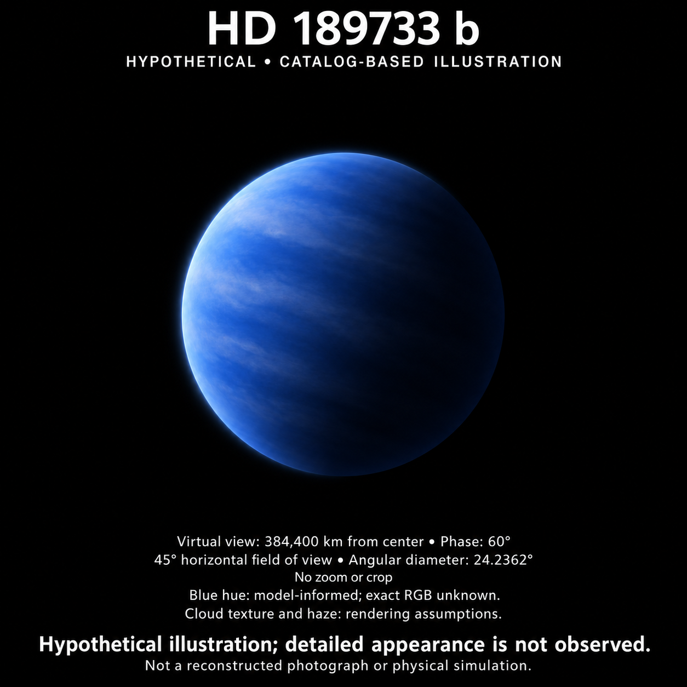
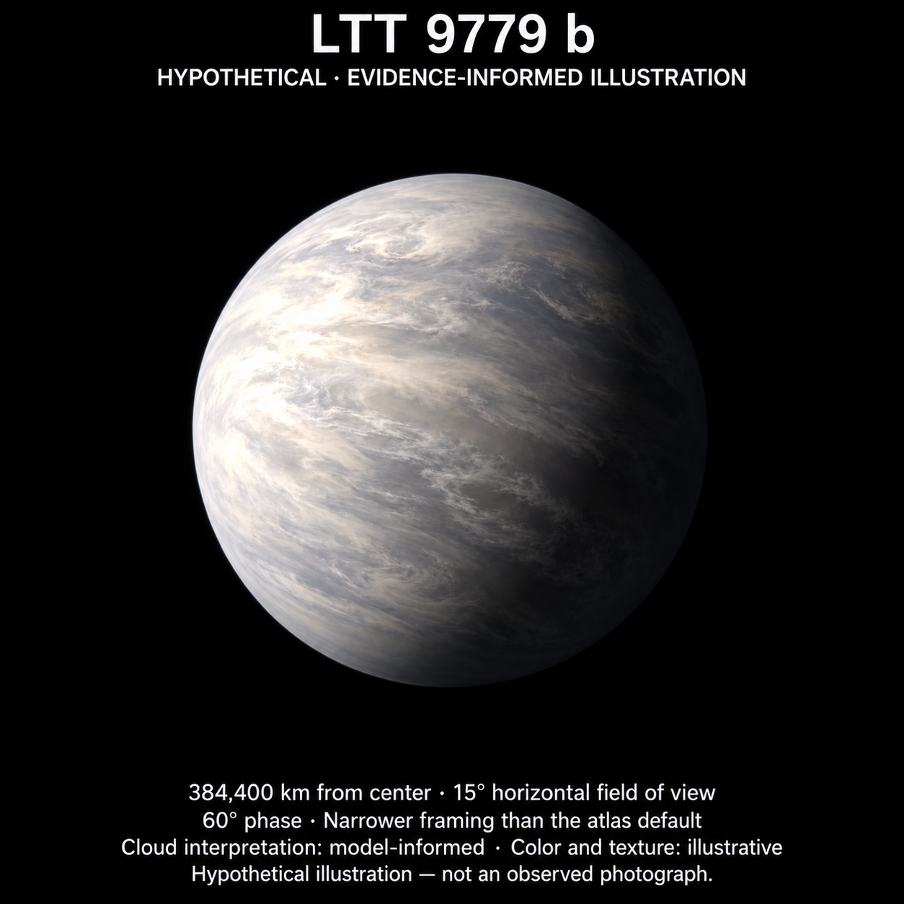
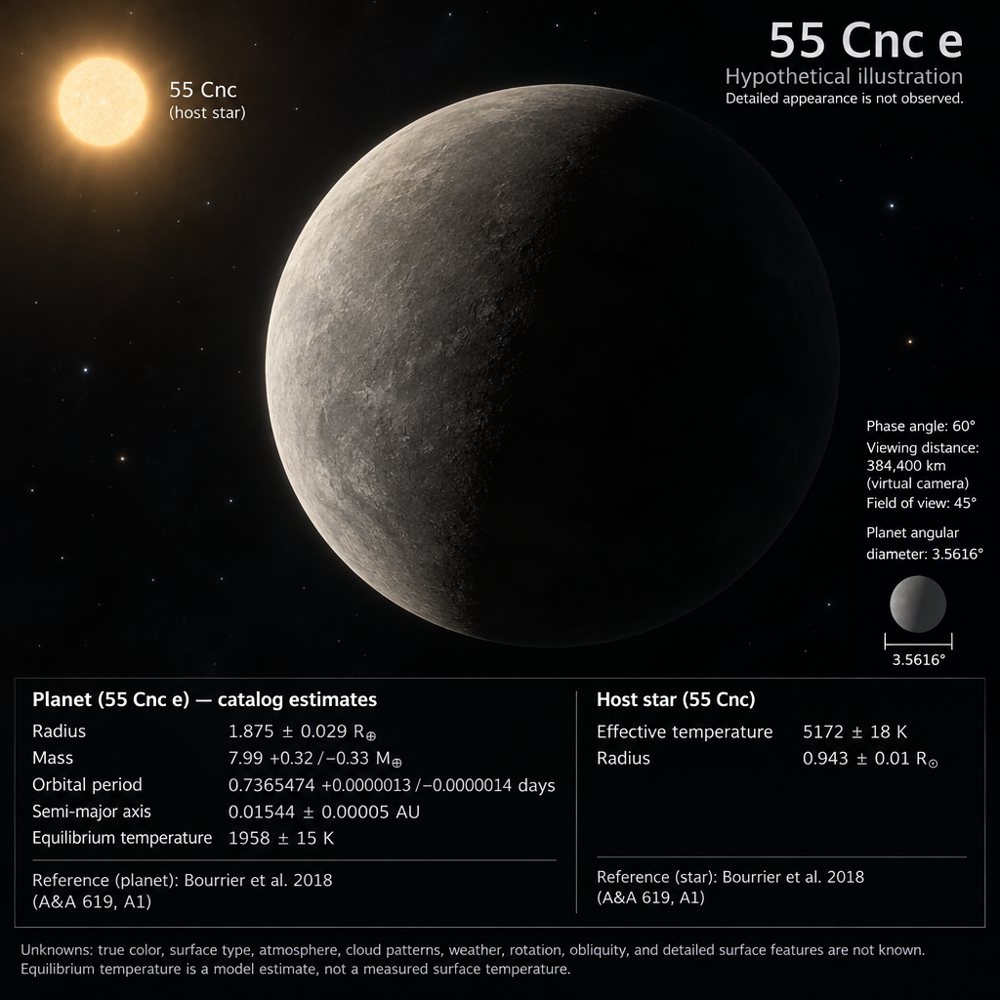
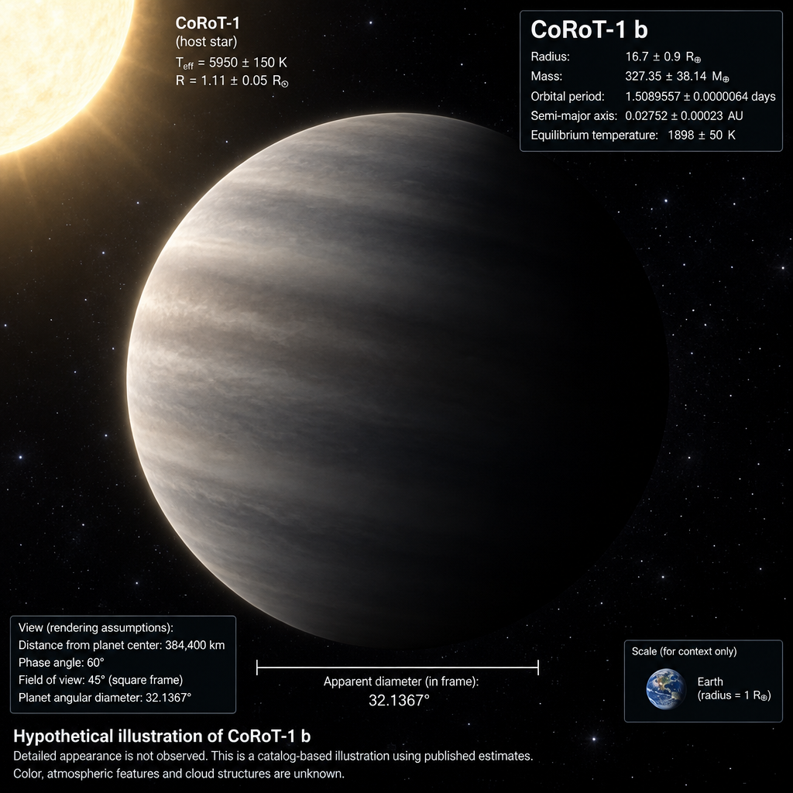

# WebbWatch AI

A public-data discovery and analysis platform for the **James Webb Space Telescope (JWST)**. WebbWatch AI watches MAST and the AWS Open Data mirror for newly public data products, generates previews, runs a deterministic-first analysis pipeline with optional local and cloud AI review, and surfaces the results in a shareable feed.

The **Exoplanet Portrait Atlas** adds a second way to explore: browse 6,451 confirmed
planets ranked by available data, review a sourced image prompt, and generate a
portrait with its **Measured / Inferred / Illustrative** evidence saved alongside it.

**[Try it on your computer](#try-it-on-your-computer)** (free, no Docker, no AI account) ·
[What costs money](docs/COSTS.md) · [MIT license](LICENSE)

See [`webbwatch_ai_project_plan.md`](./webbwatch_ai_project_plan.md) for the full design plan, schema, and roadmap.

## Planet portrait showcase

A few of the worlds we've started exploring. These are **AI-generated hypothetical
illustrations**, not telescope photographs or validated physical simulations.
Detailed appearance, rendering geometry and labels have not been independently
validated. Click an image for the full-size version; the accompanying evidence
separates published constraints from model interpretations and artistic choices.

| HD 189733 b | LTT 9779 b |
| :---: | :---: |
| [](apps/web/public/portraits/hd-189733-b/original.png) | [](apps/web/public/portraits/ltt-9779-b/original.png) |
| Our first example: a blue-hue interpretation informed by Hubble reflectance evidence. Exact color and cloud texture remain illustrative. | A reflective-cloud interpretation informed by CHEOPS, JWST, Hubble and ESPRESSO evidence. Fine cloud structure remains illustrative. |
| [Prompt](apps/web/public/portraits/hd-189733-b/prompt.txt) · [Evidence](apps/web/public/portraits/hd-189733-b/evidence.json) | [Prompt](apps/web/public/portraits/ltt-9779-b/prompt.txt) · [Framing refinement](apps/web/public/portraits/ltt-9779-b/refinement-prompt.txt) · [Evidence](apps/web/public/portraits/ltt-9779-b/evidence.json) |

| 55 Cnc e | CoRoT-1 b |
| :---: | :---: |
| [](docs/showcase/55-cnc-e/image.png) | [](docs/showcase/corot-1-b/image.png) |
| Generated directly in WebbWatch from catalog constraints. The depicted surface texture and star placement are artistic additions, not measured features. | Generated directly in WebbWatch from catalog constraints. The depicted atmospheric bands and star placement are artistic additions, not measured features. |
| [Saved prompt](docs/showcase/55-cnc-e/prompt.txt) · [Saved evidence](docs/showcase/55-cnc-e/evidence.json) | [Saved prompt](docs/showcase/corot-1-b/prompt.txt) · [Saved evidence](docs/showcase/corot-1-b/evidence.json) |

You don't need to install anything to look at these: click any image, prompt or
evidence link above. To explore all 6,451 planets yourself, follow the steps below.

## Try it on your computer

Pick how far you want to go. Each level builds on the one before it.

| You want to… | Follow steps | You need | Cost |
| --- | --- | --- | --- |
| See the curated portraits and their evidence | 1–3 | Git, Node.js | Free |
| Browse all 6,451 planets, search them, copy image prompts | 1–4 | Git, Node.js, Python | Free |
| Generate and save new portraits inside the app | 1–5 | Git, Node.js, Python, an OpenAI API key | About 2–3 US cents per image, paid to OpenAI ([details](docs/COSTS.md)) |

Steps 1–4 need **no Docker, no database server, no Redis and no AI account**, and nothing
you do in them costs money. Plan on about **1 GB of disk** and **10 minutes** the first time.

Commands marked **Windows** are for **PowerShell** (Start menu → type "PowerShell").
Commands marked **macOS / Linux** are for **Terminal**. Where only one block is shown,
it works everywhere.

### Step 1: Install the tools

| Tool | Version | Download |
| --- | --- | --- |
| Git | Any recent version | <https://git-scm.com/downloads> |
| Node.js | 20 or newer (pick the **LTS** download) | <https://nodejs.org> |
| Python | 3.12 or newer | <https://www.python.org/downloads/> |

- **Windows:** on the first screen of the Python installer, tick **Add python.exe to PATH**.
- **macOS:** the `python3` that comes with macOS is too old. Install Python from
  python.org or with Homebrew (`brew install git node python`).
- **Linux:** some distributions ship a Python older than 3.12; check below. On
  Debian/Ubuntu also run `sudo apt install python3-venv`. Distribution Node.js packages
  are often old, so prefer the nodejs.org installer.

Open a **new** terminal window (so it sees the new tools) and check the versions:

**Windows**

```powershell
git --version
node --version
python --version
```

**macOS / Linux**

```bash
git --version
node --version
python3 --version
```

You want Node `v20` or higher and Python `3.12` or higher.

### Step 2: Download WebbWatch

```bash
git clone https://github.com/bneidlinger/webb_entry.git
cd webb_entry
```

This creates a `webb_entry` folder inside whatever folder your terminal is in (usually
your home folder). Every later step starts from this `webb_entry` folder.

Prefer not to use Git? On the GitHub page choose **Code → Download ZIP** and unzip it.
The folder will be called `webb_entry-main`; use that wherever this guide says `webb_entry`.

### Step 3: Start the website

From the `webb_entry` folder:

```bash
cd apps/web
npm install
npm run dev
```

`npm install` downloads the website's libraries (about 400 MB, around a minute). It may
print warnings about "vulnerabilities". For running on your own computer you can
ignore them; don't run `npm audit fix --force`, which can break the app.

When the terminal says **Ready**, open <http://localhost:3000/exoplanets>.

**Working now:** the two curated portraits (HD 189733 b and LTT 9779 b), their
Measured / Inferred / Illustrative evidence tabs, source publications, prompts and downloads.

**Expected until step 4:** a red **API offline** badge on the homepage, a
"Couldn't reach the API" message under *Latest JWST products*, and *"The catalog is
temporarily unavailable"* on the catalog page.

Leave this window open. Closing it stops the website.

### Step 4: Start the catalog API

Open a **second** terminal window, go to the `webb_entry` folder again, and run:

**Windows**

```powershell
cd services\api
python -m venv .venv
.\.venv\Scripts\Activate.ps1
pip install -e .
python -m alembic upgrade head
uvicorn app.main:app --port 8000
```

**macOS / Linux**

```bash
cd services/api
python3 -m venv .venv
source .venv/bin/activate
pip install -e .
python -m alembic upgrade head
uvicorn app.main:app --port 8000
```

What those lines do, in order:

1. **Install.** `venv` creates a private Python environment in a `.venv` folder, so
   nothing touches your system Python. Activating it adds `(.venv)` to the start of
   your prompt. `pip install -e .` downloads the API's libraries (about 500 MB,
   a few minutes).
2. **Configure.** Nothing to do. The planet catalog ships inside the repository and
   the database is a local file by default. **Don't copy `.env.example` to `.env`** for
   this setup: that file is the Docker template and points the database at a server
   you won't have.
3. **Migrate.** Creates `services/api/webbwatch.db`, a single-file SQLite database
   where saved portraits are recorded. It's safe to run again; do so after every update.
4. **Launch.** Wait for `Uvicorn running on http://127.0.0.1:8000`.

Now refresh <http://localhost:3000/exoplanets/catalog>. You should see:

- **6,451 confirmed planets** ranked by how much published data they have (a saved
  NASA Exoplanet Archive snapshot from October 19, 2026).
- **Search and filters** by planet or host star, discovery facility, spectrum type and
  minimum score. Try searching `TRAPPIST`.
- **Planet pages** with a score breakdown, Measured / Inferred / Illustrative evidence
  tabs, links to source publications, a **Copy image prompt** button and an evidence download.
- A green **API** badge on the homepage. *Latest JWST products* now says "No products
  ingested yet". That's the separate JWST data pipeline (see [For developers](#for-developers)),
  not something the Atlas needs.

On a planet page, the **Generate image** panel will say it "needs server setup". That
is step 5, and it's optional.

#### Ideas for a first tour

1. Open `/exoplanets` and switch between the **Measured**, **Inferred** and
   **Illustrative** tabs to see which parts of a portrait come from observations and
   which are artistic choices. Follow a source link to the publication.
2. Open `/exoplanets/portraits/ltt-9779-b` for the second curated example.
3. In the catalog, open a top-ranked planet, read its score breakdown, then
   **Copy image prompt** to see exactly what an image model would be asked to draw.

#### Coming back later

You need both windows again.

- **Website:** go to `webb_entry/apps/web` and run `npm run dev`.
- **API on Windows:** go to `webb_entry\services\api` and run
  `.\.venv\Scripts\Activate.ps1`, then `uvicorn app.main:app --port 8000`.
- **API on macOS / Linux:** go to `webb_entry/services/api` and run
  `source .venv/bin/activate`, then `uvicorn app.main:app --port 8000`.

To stop either one, click its window and press **Ctrl+C**.

#### Getting updates

From the `webb_entry` folder run `git pull`. Then, before starting things as usual:

- in `apps/web`, run `npm install`
- in `services/api` with the venv activated, run `pip install -e .` and then
  `python -m alembic upgrade head`

### Step 5 (optional): Generate new portraits

> **This step costs money.** Each **Generate image** click makes one paid call to
> OpenAI's image API. Our recorded test cost about 2.3 US cents. There is no built-in
> spending cap. See the [cost guide](docs/COSTS.md) before you start.

1. Create an API key at <https://platform.openai.com/api-keys> (your OpenAI account
   needs billing set up).
2. In the **`webb_entry` folder** (not `services/api`), create a file named `.env`.
   On Windows run `notepad .env` and choose **Yes** to create it; on macOS / Linux run
   `nano .env`. Put these two lines in it, with your key on the first line, then save:

   ```dotenv
   OPENAI_API_KEY=paste-your-key-here
   PORTRAIT_GENERATION_ENABLE=true
   ```

   That's the whole file. Don't paste in the contents of `.env.example`. Git ignores
   `.env`, so your key won't be committed, but keep the file private.
3. Restart the API: press **Ctrl+C** in its window, then run
   `uvicorn app.main:app --port 8000` again. Settings are only read at startup.
4. Open a planet in the catalog. The panel shows the image model before you click.
   Select **Generate image**. The button shows "Image generating…" and the page
   updates by itself when the image is saved; you can leave it open.

Each new version is saved with the exact prompt, catalog snapshot, citations and
evidence that produced it. Find it on the planet's page, as a thumbnail in the ranked
table, and under **Saved portraits** (`/exoplanets/generated`). Files are written to
`services/api/preview_cache/planet-portraits/`. Back up that folder together with
`services/api/webbwatch.db`. Generation only works from the computer running the API.
More detail: [how portrait generation works](#generate-and-save-a-portrait-in-webbwatch).

### "Local AI" means two different things here

| | Status | What it is |
| --- | --- | --- |
| **Local report analysis** (Ollama) | Built in; advanced setup | A language model running on your own computer writes plain-language summaries of the measurements on **JWST product pages**. It needs [Ollama](https://ollama.com), Redis and the background worker in addition to step 4. See [`docs/ollama_setup.md`](docs/ollama_setup.md). **It does not make pictures** and isn't used by the Portrait Atlas. |
| **Local image generation** | **Not built in**; manual | The **Generate image** button only uses OpenAI. To use an image model on your own computer (for example FLUX.1 [schnell] in ComfyUI), click **Copy image prompt** on a planet page and paste it into that tool yourself. Download the planet's evidence and keep it with your image. This is guidance, not a tested recipe: long prompts may need careful shortening for some models, and the results aren't imported back into WebbWatch. See [local generation costs and caveats](docs/COSTS.md#local-generation-no-api-fee-but-real-operating-costs). |

### Troubleshooting

| What you see | What to do |
| --- | --- |
| `python` opens the Microsoft Store, or "is not recognized" | Reinstall Python from python.org with **Add python.exe to PATH** ticked, then open a new PowerShell window. |
| "running scripts is disabled on this system" when activating on Windows | Run `Set-ExecutionPolicy -Scope Process -ExecutionPolicy Bypass` (it affects only that window), then activate again. |
| `requires a different Python` during `pip install` | Your Python is older than 3.12. Install a newer one, delete the `services/api/.venv` folder, and redo step 4. |
| `ensurepip is not available` when creating the venv (Debian/Ubuntu) | Run `sudo apt install python3-venv`, then redo step 4. |
| `failed to resolve host 'postgres'` or other database connection errors | A `.env` copied from `.env.example` is pointing at Docker's database. Delete that `.env`, or replace it with the two lines from step 5. |
| Catalog page says "temporarily unavailable" | The API from step 4 isn't running. Check its window; <http://localhost:8000/health> should show `"status":"ok"`. |
| "address already in use" or "port is already in use" | Another copy is already running. Use it, or press **Ctrl+C** in its window first. |
| Pages suddenly show "404: This page could not be found" | Two `npm run dev` windows may be running in the same folder; on Windows the second one can start without an error. Stop both with **Ctrl+C**, delete the `apps/web/.next` folder, then run `npm run dev` once. |
| **Generate image** still "needs server setup" after step 5 | Check that `.env` is in the `webb_entry` folder, both lines are spelled exactly as shown, and you restarted the API. The panel says what's missing; use **Recheck setup**. |

Still stuck? [Open an issue](https://github.com/bneidlinger/webb_entry/issues) with your
operating system, the step and the exact error text.

This guide was last walked through end to end on a fresh clone in October 2026
(Windows 11, Python 3.13, Node.js 22), up to but not including a paid generation.
A reviewer also completed steps 1–4 on Linux.

## For developers

Everything above is the Portrait Atlas path. The rest of WebbWatch (the JWST data
pipeline, watchlists, alerts and AI reports) has more moving parts.

- **Deeper native setup**, including the worker, Redis and cloud model options:
  [`docs/local-dev-without-docker.md`](docs/local-dev-without-docker.md)
- **Local AI reports with Ollama:** [`docs/ollama_setup.md`](docs/ollama_setup.md)
- **Azure deployment:** [`docs/azure-deployment.md`](docs/azure-deployment.md)
- **Architecture, invariants and history:** [`docs/HANDOFF.md`](docs/HANDOFF.md)

For contributor tooling (tests, ruff), install the dev extras instead:
`pip install -e ".[dev]"`.

### Try the JWST data pipeline (no Docker)

After step 4, with the venv activated in `services/api`:

```bash
python -m app ingest mast --instrument NIRCAM --limit 1 --json
python -m app sample run --limit 3 --max-file-mib 16 --max-total-mib 32
python -m app sample benchmark --observations 100 --products-per-observation 10
```

`ingest` fetches a small page of real JWST metadata from MAST (queries can take
30–90 seconds). `sample run` downloads at most three small public FITS files, then
generates previews and deterministic analysis for them. It skips completed products
on rerun and makes no AI calls. `benchmark` uses synthetic metadata in an in-memory
database. Refresh the homepage to see the products; no restart is needed. On Windows, if
the CLI prints a `UnicodeEncodeError`, run `$env:PYTHONIOENCODING = "utf-8"` first.
See the [scale review and measured results](docs/HANDOFF.md#13-scale-review-and-local-validation-2026-10-01).
Exabyte-scale operation is a future architecture target, not a tested capability.

### One-command launcher (Windows)

Once steps 3 and 4 have been done once, `.\scripts\start-local.ps1` from the
`webb_entry` folder migrates the database and starts both services in the background.
Add `-Sample` to process the bounded sample first. Logs and process IDs go to `logs/`;
see [`docs/local-dev-without-docker.md`](docs/local-dev-without-docker.md) for how to stop them.

### Full stack with Docker

```bash
cp .env.example .env
docker compose -f infra/docker-compose.yml up --build
```

On Windows use `Copy-Item .env.example .env` for the first line. This starts Postgres,
Redis, Azurite (the Azure Blob emulator), the API, the worker and the website:
frontend <http://localhost:3000>, API <http://localhost:8000/health>. Inspect Azurite with
**Azure Storage Explorer** (`Local & Attached → Storage Accounts → Emulator (Azurite)`).
The Docker path hasn't been verified on the maintainer's machine yet (Docker isn't
installed there), and you don't need it for anything in the Portrait Atlas.

## Stack

Primary cloud is **Azure** for our own infrastructure. JWST public data is read anonymously from AWS (`s3://stpubdata/jwst`) because that's where STScI hosts it — no AWS credentials needed.

| Layer | Local dev | Production (Azure) |
|---|---|---|
| Frontend | Next.js + TS + Tailwind | Azure Static Web Apps |
| API | FastAPI + Python 3.12+ | Azure Container Apps |
| Workers | RQ + Redis (optional natively) | Azure Container Apps + Azure Cache for Redis |
| Database | SQLite file (native) · Postgres (Docker) | Azure Database for PostgreSQL Flexible Server |
| Object storage | Local folder (native) · **Azurite** Blob emulator (Docker) | Azure Blob Storage |
| Secrets | `.env` | Azure Key Vault (via managed identity) |
| Cloud AI | OpenAI **or** Azure OpenAI behind a provider interface (`AI_PROVIDER` env var) | Same — switchable |
| Local AI | Ollama / llama.cpp (RTX 3070, 8 GB VRAM target) | Optional self-hosted |
| Observability | structlog | Azure Monitor + Application Insights |

## Layout

```
webb_entry/
  apps/web/             # Next.js frontend
  services/api/         # FastAPI service
  services/worker/      # Background processors / analyzers
  packages/shared/      # Cross-language schemas / types
  infra/                # docker-compose, terraform, service configs
  notebooks/            # Exploratory notebooks (MAST, FITS)
  docs/                 # Architecture, runbook, data-products
```

## Status

Metadata ingestion, watchlists, previews, deterministic analysis, and optional local/cloud
AI are implemented, along with the Exoplanet Portrait Atlas described below.

## Exoplanet Portrait Atlas: how it works

### Curated portraits

`/exoplanets` (or **Portrait Atlas** on the homepage) opens the first example. It
preserves the user's HD 189733 b image and adds a keyboard-accessible
Measured / Inferred / Illustrative evidence panel, linked publications, the rendering
prompt, and downloadable image/provenance. This curated page works without the API.

The second portrait, **LTT 9779 b**, is at `/exoplanets/portraits/ltt-9779-b` and linked
from the homepage, example selector and planet catalog detail. It combines sourced
CHEOPS, JWST, Hubble and ESPRESSO constraints with a clearly hypothetical cloud
illustration. The evidence bundle retains the initial generation, framing refinement,
both prompts and image hashes. The 15° field of view is an explicit narrower framing
at the same 384,400 km distance; generated geometry and photometry remain unvalidated.
It was made with the built-in imagegen tool, separately from the in-app generation flow.

### Ranked catalog

`/exoplanets/catalog` (or **Ranked exoplanet catalog** on the homepage) browses the
full saved ranking. It needs the API but not a database server, Redis, a live archive
connection or AI credentials. The bundled snapshot contains 6,451 confirmed planets,
retrieved October 19, 2026 UTC (October 18 Pacific). It is explicitly a saved snapshot,
not a live literature review. API endpoints are `GET /api/exoplanets` and
`GET /api/exoplanets/{id}`; IDs come from the list response.

The score combines public mission evidence to prioritize planets for hypothetical
portraits. It is a catalog-availability triage proxy, not image accuracy; atmospheric
modeling and detailed appearance ranking are later milestones. Current prompts preserve
parameter citations and numerical precision; most targets default to neutral gray
until appearance evidence is curated.

### Build your own snapshot or prompt (CLI)

A runnable CLI snapshots all confirmed planets from NASA's Exoplanet Archive, exports
an explainable ranking, builds a sourced image prompt, and packages a web bundle.
From `services/api` with the venv activated (each output directory must be new):

```bash
python -m app exoplanets rank --live --output-dir ../../data/exoplanets/my-snapshot
python -m app exoplanets prompt --catalog ../../data/exoplanets/my-snapshot/catalog.json --planet "HD 189733 b" --evidence ../../packages/shared/examples/hd189733b-appearance.json --output-dir ../../data/exoplanets/my-portrait
python -m app exoplanets bundle --snapshot-dir ../../data/exoplanets/my-snapshot --evidence ../../packages/shared/examples/hd189733b-appearance.json --output-dir ../../data/exoplanets/my-web-bundle
```

Use `rank --catalog <catalog.json> --output-dir <new-directory>` for offline replay.
To refresh the web catalog, review the new bundle, then replace the three files under
`services/api/app/catalog_snapshots/exoplanets/` and restart the API. The bundle command
checks the source checksum and count, validates optional appearance evidence, strips
local paths and refuses to overwrite an existing directory.
`bundle --evidence` accepts either one appearance object or a list for multiple planets;
`prompt --evidence` takes the selected planet's single object. The original portrait
and its original prompt are retained unchanged.
See [the design, scoring rubric and research roadmap](webbwatch_ai_project_plan.md#20-exoplanet-portrait-atlas-2026-10-18).

### Generate and save a portrait in WebbWatch

Setup is [step 5](#step-5-optional-generate-new-portraits) above. Every request
freezes the exact prompt, catalog snapshot, citations, uncertainties and evidence
categories before the model runs. A new generation creates a separate version, and
`/exoplanets/generated` holds the version history. Saved pages include
image/prompt/evidence downloads and source-linked evidence tabs. Catalog detail pages
show a compact preview of the latest completed image, and the ranked table includes
clickable thumbnails; both open that version's saved prompt and evidence. A curated
example is shown when there is no completed saved version. Planets without a suitable
radius are excluded from scaled generation; unreviewed appearance remains neutral gray.
No new literature review happens automatically.

Generation uses the [OpenAI Images API](https://developers.openai.com/api/docs/guides/image-generation),
one 1024×1024 medium-quality PNG per request. The configured model is shown before
generation; override it with `PORTRAIT_IMAGE_MODEL`. The browser only receives
configuration status, never the API key. Requests execute in the API background
process without Redis. A database lock admits one active generation; request IDs
prevent duplicate paid calls. Requests are never automatically retried. A process
interruption becomes visible after the request deadline (timeout plus 120 seconds);
its saved brief remains available. Production/remote writes are disabled pending
authentication and a durable worker deployment.

Each version is stored under `services/api/preview_cache/planet-portraits/<generation-id>/`
as `image.png`, `prompt.txt` and `evidence.json`; back up that folder together with the
database. The existing Azure storage adapter is used when configured. The generated
image's scale, illumination and photometry are not independently validated.

## License

Original project code and documentation are released under the [MIT License](LICENSE).
Third-party data, publications, assets, dependencies and model weights retain their
own terms; the project license does not relicense them.

When sharing a portrait, please keep its prompt, source citations, evidence categories
and hypothetical-illustration label alongside it so viewers can assess its basis.
